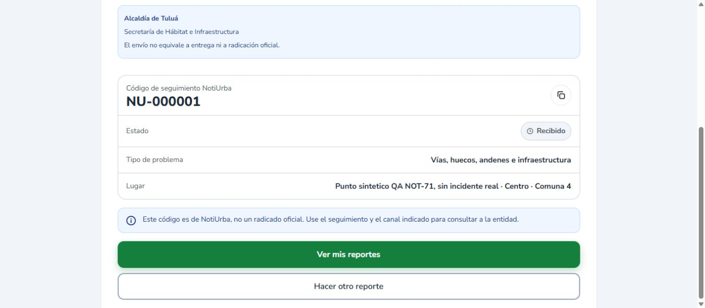

# NOT-71: correccion del arranque del almacen local QA

**Corte posterior:** el usuario ejecuto el launcher corregido con exito; foto/URL/hash y SQL aprobados a las 18:14. Confirmacion real y regresion UI sin escrituras verificadas en [validacion visual final](2026-11-08-NOT-71-validacion-visual-final-QA.md). Los pendientes inferiores corresponden al historial de preparacion, no al estado QA mas reciente. Produccion sigue pendiente.

8 de noviembre de 2026, America/Bogota. Rama `fix/registro-pr20`, HEAD `e61c44001231b595fdb2faa8866154fed79559ac`. **NOT-71 no aprobada.** Se conserva el reporte `NU-000001`, la cuenta verificada, los 135 barrios y los servicios anteriores.

## Causa comprobada y alcance

Se reprodujo la forma de lanzamiento anterior, con credencial ficticia de diagnostico y sin acceso a la base real. Java llego a Spring Boot y termino con `No qualifying bean of type org.springframework.jdbc.core.JdbcTemplate`. `loader.path` incluia todo `target/test-classes`. El escaneo de `com.notiurba` encontraba `ErroresHttpRealTest.Config`, anotada con `@SpringBootConfiguration` y `@EnableAutoConfiguration` que excluye DataSource, Hibernate y otras autoconfiguraciones. Esa configuracion pertenece a una prueba HTTP, no al backend QA. El JAR si contiene `PropertiesLauncher` y el manifiesto Boot 3.3.5 esperado; no se comprobo un JAR roto.

El launcher anterior no redirigia stdout ni stderr. Ademas `logging.file.name` se agregaba mediante un inicializador de contexto, posterior a la inicializacion del sistema de logging. Por eso un fallo temprano podia dejar sin archivo el `backend.log` sugerido. El fallo historico ejecutado por el usuario no tiene log y no puede reconstruirse literalmente; la excepcion descrita arriba es la reproducida ahora con la misma configuracion.

La primera comprobacion del logging temprano encontro otro problema verificable: el RollingFileAppender por defecto falla al interpretar llaves `{}` en las rutas temporales de esta sesion aislada. Se conserva ese intento y se sustituyo, solo en el harness QA, por FileAppender sin rotacion y ConsoleAppender. No se modifica el logging productivo.

## Archivos corregidos

- `output/iniciar-fotos-NOT71-QA.ps1`: verifica el JAR; copia exclusivamente las tres clases compiladas `Not71ServidorQA`, `Local` y `LocalPhotoStore` a un classpath temporal. No carga otras pruebas ni recursos test.
- El mismo launcher crea `backend.stdout.log` y `backend.stderr.log` antes de iniciar Java, captura ambos streams en paralelo y vacia/cierra los archivos al terminar el proceso. Registra el codigo de salida y las rutas reales. Vite tambien tiene stdout/stderr propios.
- `backend/src/test/java/com/notiurba/qa/Not71ServidorQA.java`: elimina la dependencia de la anotacion TestConfiguration ausente del JAR de runtime; conserva la fuente explicita Local con metodos Bean. Configura el archivo de logging antes de Spring y utiliza FileAppender. No genera una clave Basic inutilizada; la autenticacion sigue siendo JWT real de la aplicacion.
- El runner exige la misma base/usuario SQL, la cuenta sintetica verificada y exactamente un `NU-000001` de esa cuenta antes de escribir `ready.json`. La sonda HTTP por si sola ya no indica listo. No registra cuentas, no crea reportes, no siembra datos, no aplica migraciones.
- `output/consultar-reporte-NOT71-QA.ps1`: agrega `-PassThru` para que el launcher compruebe el resultado estructurado de la consulta de solo lectura ya existente.
- `backend/src/test/java/com/notiurba/qa/Not71AlmacenLocalTest.java`: dos pruebas focalizadas de disco/HTTP real, sin base ni credenciales. No se repitieron suites anteriores.

## Seguridad y aislamiento

Base fija `jdbc:postgresql://127.0.0.1:15435/notiurba_barrios_qa`, usuario `qa_barrios`, contenedor `notiurba-barrios-qa-20261108-153240-458c80`. La clave QA se obtiene solo en memoria del contenedor ya verificado y no se imprime. El proceso hijo tiene ambiente depurado. Flyway apagado y Hibernate validate; no DDL ni cargas. Correo apagado, proveedores externos sin credenciales y apuntando a loopback descartado. Backend nuevo 18092, Vite nuevo 5176, lectura de archivos solo 127.0.0.1:19027. Almacen temporal exclusivo, rutas por SHA256, sin listado de carpetas y solo GET. El harness sigue exclusivamente en src/test y fuera del JAR productivo.

Se conservaron 15435/18091/5175 y todos los contenedores. Nuevas comprobaciones HTTP: 5175/login 200; 18091/api/catalogos/tipos-documento 200; 18092 rechaza conexion, por lo que no se afirma que el nuevo backend este funcionando ahora. Docker devuelve permission denied al motor. V17 conserva SHA256 `e824e2b71011938b8c0666f07b302ac537a81bd27865689055048fb503dd4fec`; B01-B05 y los archivos preparados no se alteraron.

## Validaciones efectivamente ejecutadas

| Comprobacion | Resultado real |
|---|---|
| Sintaxis PowerShell de launcher y consulta SQL | APROBADA, 0 errores |
| PropertiesLauncher, manifiesto y aplicacion dentro del JAR | APROBADA por inspeccion ZIP |
| Compilacion Maven offline test-compile | BUILD SUCCESS; clase compilada verificada tambien con javap |
| Fallo antes de Spring, clase principal inexistente | Prueba negativa APROBADA: exit 1, stdout y stderr creados, stderr de 172 bytes |
| Classpath aislado del harness | Solo las tres clases previstas; no ErroresHttpRealTest ni recursos test |
| Arranque corregido con clave ficticia, sin conexion real | Spring crea backend.log, intenta Hikari/JDBC y registra Permission denied de sockets. Ya no presenta el fallo anterior de ausencia de JdbcTemplate. No acredita conexion a QA ni readiness del reporte |
| Dos pruebas nuevas disco/HTTP | Ejecutadas: 2 errores de entorno, 0 fallos de asercion; HttpServer no puede crear loopback por Permission denied. NO aprobadas ni omitidas |
| Subida por el adaptador, URL y SQL | PENDIENTES de ejecutar el launcher corregido desde Windows con acceso al contenedor. Se automatizan, no se dan por aprobadas |
| Confirmacion visual en Chrome | APROBADA su apertura directa autenticada en 5175: Reporte guardado, NU-000001, Recibido, Centro, comuna 4, Alcaldia / Secretaria de Habitat e Infraestructura; correo PENDIENTE |
| Navegacion automatica despues del guardado | PENDIENTE de regresion: abrir directamente la ruta final no demuestra la transicion desde el POST. No se crea otro reporte para probarla |

## Unica ejecucion necesaria en Windows

PowerShell 7:

```powershell
& 'C:\notiurba\noti-urba\output\iniciar-fotos-NOT71-QA.ps1'
```

El script corregido conserva los servicios anteriores y continua automaticamente: usa el JPEG publico ya descargado (o descarga el mismo original), exige 84460 bytes y SHA256 esperado, inicia sesion con la cuenta sintetica existente, consulta `NU-000001` y adjunta solo si no tiene foto. No duplica el reporte ni solicita correo. Si existe otra foto distinta se detiene conservandola. Si la foto esperada ya esta asociada no vuelve a subirla.

Para aprobar exige POST 201 cuando corresponda, GET del reporte con una unica asociacion de esa URL, recuperacion HTTP local y SHA256 identico, y SQL de solo lectura con codigo, cuenta, categoria, coordenadas, comuna, destino y foto del usuario 2. Guarda estados/resultado y SQL en `evidencias-NOT-71-reporte-20261108/foto-local-*.json`. No guarda JWT, contrasenas, cabeceras ni contenido de login. Las excepciones completas del cliente HTTP no se vuelcan a la evidencia.

Si Java termina, indica codigo de salida y stdout/stderr reales, mas backend.log si Spring alcanzo el logging. Si hay timeout no mata procesos existentes. La ruta temporal se imprime antes del lanzamiento. La foto recuperada se guarda alli tambien. No repetir el comando si ya hay un backend nuevo activo: el control de puertos se detiene para conservarlo.

Pantalla final comprobada: `http://127.0.0.1:5175/reportar/enviado/NU-000001`. Frontend nuevo previsto despues del arranque exitoso: `http://127.0.0.1:5176/login`.

## Evidencias y cierre

Carpeta `evidencias-NOT-71-arranque-20261108/`: script original respaldado, extracto de salida de la reproduccion original, prueba negativa de bootstrap, intento intermedio Logback conservado, stdout/stderr y backend.log del diagnostico final, JSON de clases/logging, resultados de las dos pruebas bloqueadas, servicios HTTP y capturas autenticas de confirmacion. Los archivos temporales completos de la primera reproduccion no fueron recuperables en una llamada posterior; el extracto procede de la salida efectivamente observada. No se aplico V17, no hubo cambios productivos, commits, push, PR, despliegues o envio a entidades.



**NOT-71 permanece In Review/no aprobada.** Falta ejecutar la subida local recuperable y SQL sobre el adaptador corregido, verificar la transicion automatica de confirmacion y demostrar por separado la E2E autorizada en Netlify/Render/Neon. Este trabajo no acredita Cloudinary productivo ni modifica el bloqueo productivo del catalogo.


## Conservacion tras limpieza del 11 de noviembre de 2026

Los logs completos, intentos fallidos provisionales y copias de builds remotos se retiraron del seguimiento. Las menciones anteriores describen el ensayo historico, no dependencias de ejecucion ni enlaces de descarga actuales. Se conservan los resultados resumidos, capturas unicas, hashes y scripts vigentes. El inventario exacto y la recuperacion historica estan en [el informe de limpieza](2026-11-11-limpieza-repositorio.md).
