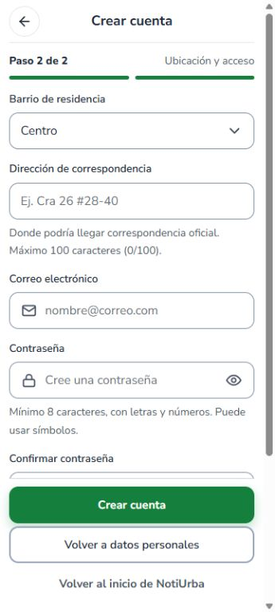
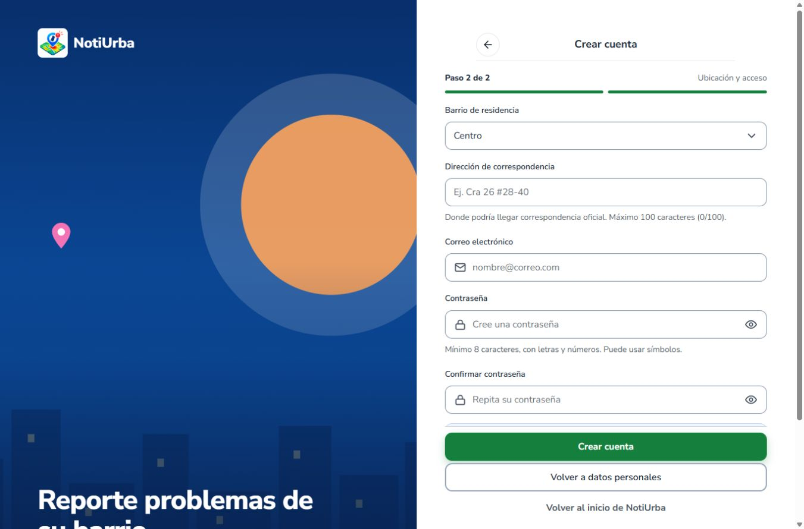
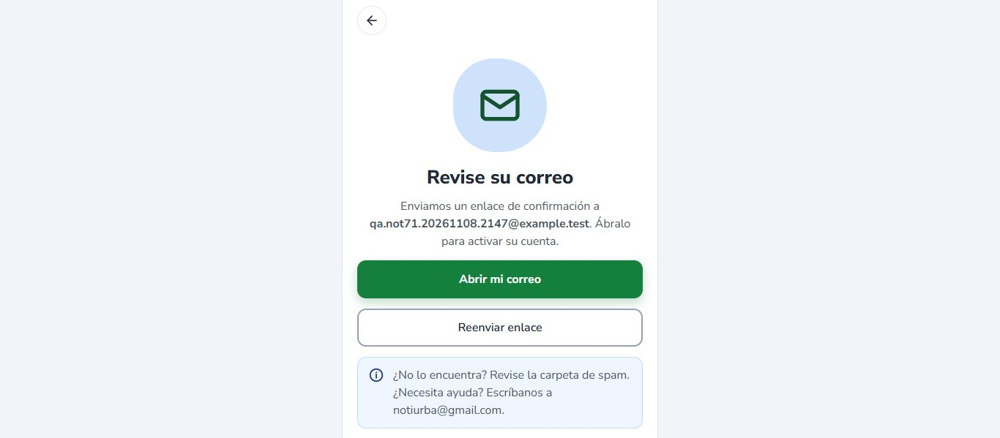
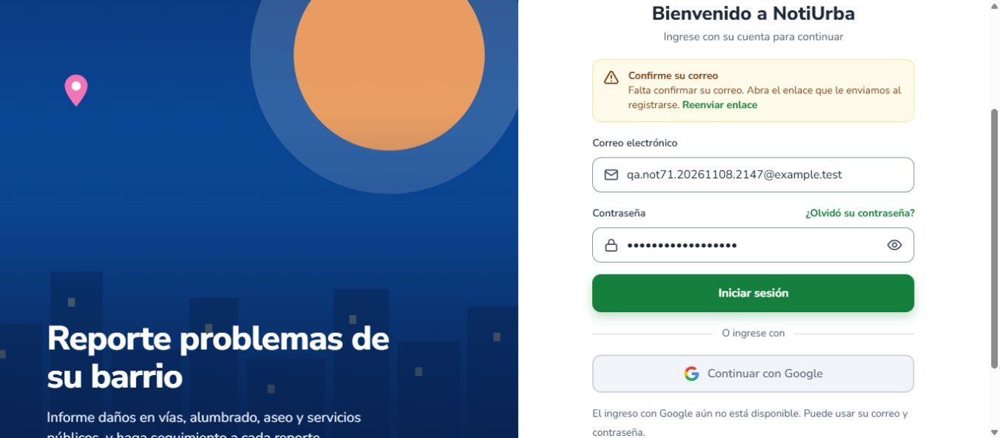

# NOT-71 — Resultado final de la revisión QA y preparación del catálogo

> Tramo posterior con cuenta verificada: se creó y consultó `NU-000001` en QA. La foto devolvió 502 por almacén no disponible; SQL y confirmación visual final siguen pendientes. Véase [continuación del reporte](2026-11-08-NOT-71-reporte-QA.md), que actualiza los bloqueos históricos descritos abajo.

> Continuación posterior: Render volvió a responder HTTP 200 con `[]`; el auxiliar de verificación QA quedó preparado pero bloqueado por acceso a Docker. Véase la actualización al final. Las pruebas aprobadas de barrios, registro HTTP 201 y responsive no se repitieron.

Fecha: 8 de noviembre de 2026, revisión posterior a la recuperación del entorno. **NOT-71 no puede cerrarse.** La visualización interactiva de los 135 barrios y el alta ciudadana funcionan en QA; la sesión verificada y el reporte integral no se completaron. En producción no se demostró el criterio de aceptación.

## Entorno y preservación

Repositorio `C:\notiurba\noti-urba`, rama `fix/registro-pr20`, HEAD `e61c44001231b595fdb2faa8866154fed79559ac`. Al inicio existían sin seguimiento el informe/capturas de la revisión anterior y `output/recuperar-barrios-qa.ps1`; se conservaron. No se cambió de rama ni se crearon commits, PR, push, merges o despliegues.

| Componente | Comprobación actual |
|---|---|
| Frontend QA | `http://127.0.0.1:5175/registro`; Chrome real. |
| API QA directa | `http://127.0.0.1:18091/api/catalogos/barrios`: HTTP 200, 135 registros. |
| API vía Vite | `http://127.0.0.1:5175/api/catalogos/barrios`: HTTP 200, 135 registros, sin cabecera de origen Render. |
| Configuración servida | `VITE_USAR_MOCKS=false`, `VITE_API_URL=""`; API relativa del servidor QA local. |
| Centro | ID 43, comuna 4; coincide en ambos endpoints. |
| PostgreSQL QA informado | `127.0.0.1:15435`, contenedor `notiurba-barrios-qa-20261108-153240-458c80`. |
| Acceso directo a base/motor | La terminal devolvió permiso denegado al motor Docker. No se verificó nuevamente por SQL el contenedor, usuario, historial ni persistencia. |

Los endpoints y el registro local están operativos; esto no sustituye una consulta SQL autenticada. No se ejecutó el recuperador ni se crearon/detuvieron contenedores o volúmenes. No se inspeccionaron ni reutilizaron credenciales productivas.

## Casos ejecutados

| Caso | Resultado | Evidencia / límite |
|---|---|---|
| Campos personales vacíos | APROBADO QA | Mensajes para nombres, apellidos, tipo y número; foco en nombres. |
| Selector | APROBADO QA | 135 opciones con valor en el DOM, respuesta real sin mocks. |
| Centro y navegación | APROBADO QA | Centro 43 conservado tras volver a datos personales y avanzar. |
| Cambio de barrio | APROBADO QA | Alvernia 14 conservado tras volver/avanzar; se restableció Centro. |
| Aviso de privacidad | APROBADO QA por teclado | Enter abre aviso versión 3 dentro del formulario; volver conserva Centro. |
| Responsive 360/1366 | APROBADO en los puntos examinados | `innerWidth=360/1366`, ancho documento 345/1351 (barra de scroll), sin desbordamiento horizontal. Casilla y botones inferiores alcanzables por scroll a 360; no es prueba de teclado móvil físico. |
| Registro real | APROBADO QA a nivel HTTP/UI | POST vía Vite a `/api/auth/registro` devolvió 201 y mostró «Revise su correo». |
| Persistencia de cuenta por SQL | BLOQUEADO | No hay conexión SQL autenticada accesible. No se sustituye por una inferencia del 201. |
| Login sin confirmar correo | RECHAZO ESPERADO comprobado | HTTP 403 `CORREO_NO_VERIFICADO` con la cuenta creada; UI «Confirme su correo». |
| Sesión verificada de la cuenta nueva | BLOQUEADO | Sin enlace de confirmación utilizable en el entorno QA actual; no se activaron proveedores productivos ni se alteró el estado de verificación por SQL. |
| Crear reporte sin sesión | PROTECCIÓN comprobada | `/reportar` muestra «Inicie sesión para crear un reporte». |
| Retorno al reporte tras autenticarse | BLOQUEADO | No se obtuvo sesión verificada. No se acredita retorno integral. |
| Categoría, descripción, mapa, foto y envío del nuevo reporte | NO EJECUTADOS / BLOQUEADOS | El catálogo de categorías y el flujo requieren sesión. No se fabricó token ni se habilitaron credenciales productivas. |
| Persistencia de código, usuario, categoría, coordenadas, comuna, destino y foto | BLOQUEADO | No se creó reporte con esta cuenta y no se ejecutó SQL directo. |

Cuenta sintética creada solo en QA: `qa.not71.20261108.2147@example.test`, documento `9711082147`, barrio 43. No se guarda su contraseña en este informe. No se pidió reenvío de correo ni se envió un reporte a entidades. La pantalla de registro afirma envío de enlace; ese texto y el 201 **no acreditan entrega de correo**, y en esta revisión no se comprobó entrega alguna.

## Fallas, observaciones y correcciones

No se confirmó un defecto del catálogo en los casos QA ejecutados. El rechazo de login por correo sin confirmar es comportamiento esperado, aunque bloquea este ensayo integral.

Se observó dos veces que un clic automatizado centrado sobre el enlace de privacidad que se parte en dos líneas alternaba la casilla sin abrir el aviso. Enter sobre el enlace sí abrió el diálogo y permitió regresar conservando datos. Registrar como observación de interacción que requiere confirmación manual sobre el texto del enlace; no se atribuye a producción ni se presenta como defecto funcional definitivamente diagnosticado. No se modificó código React/CSS por esta observación.

No se realizaron correcciones de lógica backend/frontend. Se añadieron evidencias, preparación SQL y documentación; se preservaron V17 y los documentos fuente del catálogo.

## Preparación de los 135 barrios

Se ejecutó `output/preparar-not71-catalogo.cjs` contra artefactos locales y la respuesta QA guardada. SQL candidata, CSV y API QA coinciden en sus 135 claves naturales `(id_comuna,nombre)`. Hay 135 pares únicos, 0 duplicados normalizados dentro de una comuna, comunas 1–10 y nombres de hasta 27 caracteres frente al límite 100 del esquema. Distribución por comunas 1–10: 12/8/21/5/16/16/21/18/15/3.

SHA-256 de V17: `e824e2b71011938b8c0666f07b302ac537a81bd27865689055048fb503dd4fec`. CSV: `fce84f32cfcbd1324b5fa9a8c9b6aa199dfe63d36d212c41297f6766a1744ecc`. Coinciden con `revision-andres.json`. La candidata original no cambió; continúa fuera de Flyway activo. El checkout activo conserva V1–V16, sin V17 activa.

Se reutiliza la evidencia previa `CatalogoCargaBarriosIT`: primera carga 135, segunda 0, 136 totales incluyendo el interno, FK válidas e interno excluido. **No se reejecutó esa integración ni una migración Flyway nueva.** La comparación actual con API verifica datos expuestos, no historial ni todas las restricciones SQL actuales.

El [paquete de preparación](../../backend/migraciones-pendientes/barrios-pmgr-2020/preparacion-NOT71-20261108/GUIA-APLICACION.md) incluye:

- Preflight de solo lectura con destino, historial, inventarios, FK/unicidad y conflictos de nombres/internos.
- Postflight por claves naturales, conteos previstos, registros adicionales existentes, internos y FK huérfanas.
- Reejecución de V17 limitada a QA precargada dentro de transacción con ROLLBACK.
- Consulta de solo lectura del usuario sintético y sus futuros reportes/fotos/destinos.
- Secuencia de aprobación, numeración Flyway, respaldo y restauración aislada, recuperación y verificación de frontend.

**Los cuatro SQL nuevos están preparados, no ejecutados.** Su validación de ejecución queda pendiente del acceso al motor/base. No se afirma que se haya creado o restaurado un respaldo de PostgreSQL.

Las decisiones B01–B05 continúan pendientes: El Principio/El Príncipe; variantes de Lusitania; Diablos Rojos 7/8; San Luis/Urbanización San Luis; Santa Inés/Santa Inés-Comfamiliar. B03/B05 tienen aclaración documental previa, no aprobación. Andrés debe aprobar nombres/asociaciones, vigencia o uso histórico provisional, CSV/SQL finales y hashes. La fuente PMGR 2020 no certifica vigencia administrativa en 2026.

No es necesario conservar IDs 43 o 14 al migrar a otro destino. `ON CONFLICT (id_comuna,nombre) DO NOTHING` evita duplicados exactos, pero no resuelve alias, errores de comuna o coincidencias internas. El número de barrios públicos total puede superar 135 si ya existían otros válidos; verificar las 135 claves aprobadas y el incremento previsto, preservando todo registro existente.

La comuna del reporte se deriva mediante `v_reporte_comuna` (V13), no es una columna persistida en `reporte`. El barrio del usuario no acredita la comuna del incidente. El destino derivado debe contrastarse con la categoría y, cuando exista, el destino/mensaje congelado de `registro_envio_correo`. Estas comprobaciones del mismo reporte siguen pendientes.

## Producción y criterio de cierre

Netlify `/registro` respondió HTTP 200. Dos GET a Render `/api/catalogos/barrios` agotaron 20 segundos cada uno: **no hubo respuesta HTTP en esta revisión**. No se interpreta un timeout como catálogo vacío ni como estado HTTP del servidor. La evidencia anterior sigue siendo HTTP 200 `[]`; su corrección actual no está demostrada.

No se ejecutó registro productivo, no se modificó Neon, no se aplicó V17 y no se desplegó. No hay evidencia de un recorrido único Netlify → Render → base con registro, login verificado, reporte, foto recuperable, comuna, destino y código.

Para cerrar NOT-71 deben resolverse catálogo aprobado/disponible y alcance de las decisiones pendientes; obtener respaldo recuperable y autorización de migración; comprobar API/selector reales; disponer de una cuenta, confirmación de correo y almacenamiento para el ensayo sintético autorizado sin correos a entidades; ejecutar el recorrido y las consultas SQL del mismo reporte. **Se conserva NOT-71 en revisión, sin recomendar Done.**

## Evidencias nuevas

[Carpeta](evidencias-NOT-71-final-20261108/): `catalogo-qa.json`, `visual.json`, `registro-http.json`, `login-http.json`, `flujo-bloqueado.json`, `produccion-http.json` y capturas Chrome reales.

## Continuación: confirmación controlada de correo pendiente por acceso a QA

Se revisaron `VerificacionServicio`, `TokenVerificacionRepository` y `TokenVerificacion`: token aleatorio de 32 bytes, hash SHA-256, vigencia original de 24 horas, bloqueo pesimista al consumir y rechazo de tokens vencidos/usados/inexistentes. El correo solo se confirma al consumir un token válido. Como solo se almacena el hash, no es posible recuperar el enlace original a partir de la base. No se extrajeron credenciales ni se intentó adivinar el token.

Nueva comprobación real: `POST http://127.0.0.1:18091/api/auth/verificar` con un token deliberadamente inexistente respondió **HTTP 400 `ENLACE_INVALIDO`**, campo `token`. Es una comprobación negativa de seguridad, no una confirmación de la cuenta.

Se preparó [verificar-cuenta-NOT71-QA.ps1](../../output/verificar-cuenta-NOT71-QA.ps1), con [instrucciones y límites](../../output/verificar-cuenta-NOT71-QA.md). Su fixture se limita al contenedor/base/cuenta sintética aprobados, crea un hash de token efímero y utiliza el endpoint real para consumirlo. No modifica directamente el estado de verificación ni añade un acceso alternativo. Comprueba el uso único, login real y estado SQL sin publicar JWT ni tokens. No envía correos y no usa credenciales productivas.

La sintaxis del auxiliar pasó la comprobación PowerShell. **La ejecución se detuvo en el control inicial: «Motor Docker inaccesible: detenido antes de modificar QA».** Por ello no se insertó el fixture, no se confirmó la cuenta y no se ejecutaron login posterior, reporte con foto ni consulta SQL de persistencia. El bloqueo es de acceso técnico al motor desde esta sesión; no falta autorización del usuario para la operación QA solicitada.

El recuperador de QA define claves de Cloudinary vacías y URL de proveedor local no disponible; se conserva esa configuración y no se activaron credenciales productivas. No hubo una subida autenticada en esta continuación ni se verificó de nuevo la configuración efectiva de almacenamiento. La foto sigue **no probada/bloqueada**, sin atribuir un HTTP de subida que no se ejecutó.

Render sí respondió en esta continuación: `GET https://notiurba-api.onrender.com/api/catalogos/barrios` devolvió **HTTP 200 con `[]`, 0 barrios**. Este resultado sustituye la incertidumbre de los timeouts del corte anterior y confirma el bloqueo productivo del catálogo. No se modificó Neon ni hubo despliegues o escrituras productivas.

Se mantuvieron las aprobaciones QA anteriores sin repetirlas. Netlify/Render: pendiente el recorrido autenticado desplegado con foto, comuna, destino y código. Neon/base productiva: pendientes las consultas del mismo reporte y cualquier migración expresamente aprobada. V17, los SQL preparados y B01–B05 siguen intactos y pendientes de autorización. **NOT-71 continúa In Review, no aprobada.**

Evidencia nueva: [comprobaciones HTTP](evidencias-NOT-71-continuacion-20261108/comprobaciones-http.json). No hay capturas nuevas de un recorrido que no pudo ejecutarse.
