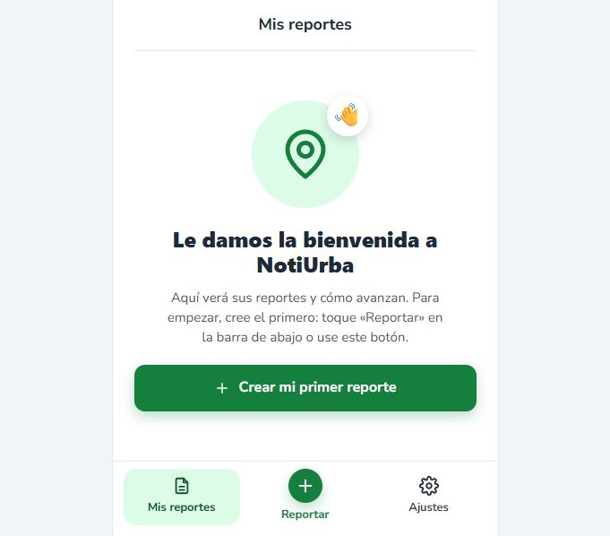
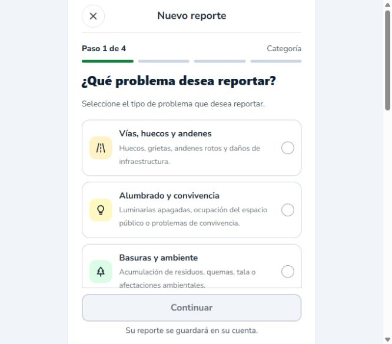

# NOT-71 — Continuación con cuenta verificada y creación de NU-000001

**Actualizacion mas reciente:** [validacion visual final y navegacion segura QA](2026-11-08-NOT-71-validacion-visual-final-QA.md). La foto/URL/hash y SQL quedaron aprobados en las evidencias ejecutadas por el usuario a las 18:14. Confirmacion real aprobada a 360/1366 px; regresion de navegacion con el mismo codigo aprobada mediante nueve comprobaciones UI aisladas sin escrituras al backend. NOT-71 sigue In Review por el recorrido productivo pendiente.

## Historial anterior (los bloqueos resueltos se actualizan en el corte enlazado)

8 de noviembre de 2026. Rama `fix/registro-pr20`, HEAD `e61c44001231b595fdb2faa8866154fed79559ac`. **NOT-71 no aprobada.** Se ejecutaron el login visual y la creación/consulta real de un reporte QA; la foto falló por almacenamiento no disponible y la consulta SQL del reporte quedó bloqueada por permisos de Docker.

No se repitieron registro, recuperación del catálogo, responsive ni verificación de correo. Se leyeron los resultados existentes `verificacion-controlada-20261108-161627.json` y `161758.json`: endpoint real de verificación HTTP 200, rechazo de reutilización HTTP 400, login HTTP 200 y SQL que identifica la cuenta verificada como usuario 2 de `notiurba_barrios_qa`. Son evidencia previa ejecutada por el usuario desde Windows, no consultas nuevas de esta sesión.

## Casos y resultados reales

| Caso | Resultado y alcance |
|---|---|
| Login visual de la cuenta sintética | APROBADO QA: Chrome abrió `/app/reportes` y mostró «Mis reportes» / «Crear mi primer reporte». |
| Navegación a Crear reporte | APROBADO QA: formulario `/reportar`, categorías reales del backend. |
| Categoría | Seleccionada categoría 1, Vías, huecos, andenes e infraestructura. |
| Ubicación | Punto marcado en mapa; coordenadas leídas posteriormente del reporte: latitud 4.084847878371718, longitud -76.1953353881836. Centro seleccionado como barrio del incidente. |
| Descripción y revisión | Texto explícitamente sintético, sin incidente real. Resumen visual mostró categoría, Centro, punto, descripción y destino. |
| Selección visual de archivo | BLOQUEADA por permiso de archivos de la extensión de Chrome. El selector se abrió, pero `setFiles` exigió acceso a archivos locales. No se modificó el permiso ni se acredita vista previa/adjunto visual. |
| Crear reporte | APROBADO QA: POST vía Vite a `/api/reportes` → HTTP 201, código **NU-000001**. Se creó sin foto; no se volvió a crear después. |
| Solicitud de correo en QA | HTTP 202 en `/api/reportes/NU-000001/enviar`; consulta posterior muestra PENDIENTE. No acredita entrega ni radicación. La configuración QA mantiene el procesador de correo deshabilitado; no se activaron proveedores ni credenciales externas. |
| Pantalla final automática | FALLÓ en la ejecución observada: tras guardar volvió a `/reportar`, paso Categoría, en vez de mostrar el código. Captura y tráfico conservados. Causa pendiente de diagnóstico; no se atribuye a producción. |
| Consulta autenticada por código | APROBADO por HTTP: GET `/api/reportes/NU-000001` → 200, recupera categoría, descripción, punto, comuna 4, Centro y estado Recibido. |
| Consulta de destino | GET `/api/reportes/NU-000001/envio` → 200, PENDIENTE, Alcaldía de Tuluá / Secretaría de Hábitat e Infraestructura; canal 1, código A01, CAIC como destino. |
| Fotografía real por API | NO APROBADA: POST multipart al backend QA sobre el mismo código → **HTTP 502 ALMACEN_FOTOS_NO_DISPONIBLE**, campo foto. No se interceptó ni simuló la respuesta. |
| Persistencia de fotografía / URL | NO APROBADA: consulta del reporte devuelve `fotos: []`; no existe URL de foto recuperable en este caso. |
| Consulta SQL del reporte | BLOQUEADA: `docker exec ... psql` devolvió permission denied. La consulta HTTP no se presenta como SQL directo. |
| Consulta visual final por código | BLOQUEADA adicionalmente por fallos de conexión/CDP al intentar abrir las rutas finales y de detalle. No se inventa una captura de confirmación. |

## Datos del caso

Cuenta sintética: `qa.not71.20261108.2147@example.test`, usuario 2 según SQL previo. API de esta ejecución `http://127.0.0.1:18091`, frontend `http://127.0.0.1:5175`. Base QA informada y ya verificada por el usuario: `notiurba_barrios_qa`, puerto local 15435, contenedor `notiurba-barrios-qa-20261108-153240-458c80`.

El reporte `NU-000001` responde HTTP 200 a esa cuenta autenticada. Está Recibido y se deriva comuna 4. No se confunde la comuna del reporte con el barrio de residencia del usuario. El destino se leyó del endpoint de estado/ruta; la comprobación de su persistencia y del mensaje congelado por SQL aún no se ejecutó.

Imagen sintética generada para la prueba: PNG RGB 512×384, 222890 bytes, sin personas, ubicación real ni datos personales. Su archivo y la respuesta HTTP 502 están conservados. El POST multipart se realizó por HTTP real al mismo código después de que el permiso de Chrome bloqueara la selección de archivo. Eso prueba el rechazo del almacén, no la selección visual ni una subida exitosa.

## Almacén aislado preparado

Los puertos 19025/19026 del QA anterior de NOT-25 rechazaron conexión. Se reutilizó su contrato de almacenamiento local, sin arrancar su fixture de usuario/barrio ni utilizar su base diferente.

Se añadió **solo en `src/test/java`** [Not71ServidorQA.java](../../backend/src/test/java/com/notiurba/qa/Not71ServidorQA.java): arranque manual con base QA fija en 127.0.0.1:15435, usuario SQL qa_barrios, esquema existente validado y Flyway deshabilitado. Almacén real de archivos y HTTP de lectura en loopback; no intercepta endpoints Spring. Correo deshabilitado, proveedores externos sin claves, JWT propio de pruebas. No forma parte del JAR productivo.

Compilación offline `mvn -DskipTests test-compile`: **BUILD SUCCESS**, salida 0. No se ejecutaron suites ya aprobadas. La compilación acredita tipos y dependencias, no el arranque o funcionamiento del almacén.

Se prepararon [launcher aislado](../../output/iniciar-fotos-NOT71-QA.ps1), [consulta SQL de solo lectura](../../output/consultar-reporte-NOT71-QA.ps1) y [guía](../../output/almacen-fotos-NOT71-QA.md). Ambos scripts pasaron análisis de sintaxis PowerShell. El intento de ejecutar el launcher se detuvo en el control inicial: Docker inaccesible, antes de iniciar servicios o cambiar datos. Por tanto **el almacén nuevo está preparado/compilado, no ejecutado ni aprobado**.

Cuando sea accesible desde Windows, el launcher crea procesos independientes en 18092/19027/5176 y conserva 18091/5175 y todos los contenedores. Reutiliza la cuenta verificada y `NU-000001`; no repetir registro ni crear otro reporte. Tras reintentar solo la foto, exigir 201, GET del mismo reporte, URL local 200 con bytes/hash correspondientes y consulta SQL del mismo código. Los comandos están en la guía.

## Estado de NOT-71 y restricciones

No se modificaron Neon, Render, Netlify o Cloudinary, ni se aplicó V17. No hubo commits, PR, push, merges, despliegues, eliminación de contenedores/volúmenes o credenciales productivas en QA. Se conservaron todos los cambios previos, migraciones preparadas y decisiones B01–B05.

Las verificaciones productivas no se repitieron en este tramo: el último resultado documentado de Render es HTTP 200 `[]`. La E2E real Netlify → Render → Neon sigue pendiente: catálogo aprobado/disponible, cuenta y servicios de ensayo autorizados sin correo a entidades, reporte con foto recuperable, comuna/destino/código y persistencia SQL del mismo caso. **El éxito parcial de QA no permite cerrar NOT-71.**

## Evidencias auténticas

[Carpeta de este caso](evidencias-NOT-71-reporte-20261108/): login visual, retorno inesperado a Categoría, creación 201/solicitud 202, consulta HTTP de reporte/destino, imagen sintética y rechazo HTTP 502. Sin contraseñas ni tokens en las evidencias.






## Continuacion: fotografia publica de Internet (2026-11-08)

Se descargo el original JPEG Pothole Small, de Uncl3dad, Wikimedia Commons, dedicado al dominio publico por su titular (PD-self). Fuente y licencia: https://commons.wikimedia.org/wiki/File:Pothole_Small.jpg . Archivo temporal: `C:/Users/Usuario/AppData/Local/Temp/not71-foto-internet-20261108/Pothole_Small.jpg`. Dimensiones 468 x 309, 84460 bytes, MIME image/jpeg, dentro del limite de 1048576 bytes. SHA256 `761d2113cbbccd6600366f6885f1cc1e656d33476780628150878faf178b6b67`. No se modifico la imagen. Procedencia conservada en `evidencias-NOT-71-foto-internet-20261108/procedencia.json`.

Login HTTP real a 18091: 200. Se reutilizo exclusivamente NU-000001: GET previo 200, POST multipart `/api/reportes/NU-000001/fotos` con el JPEG publico: **502 ALMACEN_FOTOS_NO_DISPONIBLE**, GET posterior 200 y `fotos: []`. No se creo otro reporte ni se volvio a solicitar correo. Evidencia sanitizada: `evidencias-NOT-71-foto-internet-20261108/resultado-http.json`. No hay fotografia asociada ni URL recuperable aprobadas. El fallo sigue en el almacenamiento QA; el JPEG compatible no lo soluciona.

Docker continua denegando acceso al motor named pipe desde esta sesion. El backend aislado alternativo 18092 no estaba iniciado. Se conserva el adaptador de pruebas ya compilado y el launcher existente, sin introducir otro recuperador ni detener servicios. **Su funcionamiento sigue sin validarse**. Unico comando de arranque necesario desde PowerShell 7 de Windows:

```powershell
& 'C:\notiurba\noti-urba\output\iniciar-fotos-NOT71-QA.ps1'
```

La consulta SQL del reporte sigue bloqueada por ese permiso. El script de solo lectura existente `output/consultar-reporte-NOT71-QA.ps1` queda preparado; no se presenta el GET HTTP como comprobacion SQL. Comuna 4 y coordenadas siguen siendo datos leidos por API, destino leido previamente por API; no se acredita persistencia SQL nueva.

### Ajuste local de confirmacion

Se encontro que PasoConfirmacion llamaba limpiar() antes de navigate(). Al quedar el borrador y el guardado vacios mientras aun se renderizaba el paso 4, su guarda podia redirigir a Categoria. Se retiro la limpieza previa y ReportarLayout consume/limpia el guardado solo cuando la URL ya coincide con `/reportar/enviado/` y el codigo guardado. Es un ajuste local, no desplegado. ESLint de los dos archivos modificados: salida 0. Build Vite: salida 0, 237 modulos. No se repitieron registro, responsive ni catalogo.

**Verificacion visual de la correccion pendiente:** Chrome volvio a fallar por timeout de conexion; el intento nativo termino porque el control no pudo determinar con confianza la URL actual. No se obtuvo captura nueva ni se declara aprobada la navegacion automatica corregida. No se creo un segundo reporte para forzar una prueba.

V17, la preparacion de migracion y B01-B05 se conservan sin cambios. NOT-71 permanece In Review/no aprobada. Pendientes: almacenar y recuperar la foto sobre el mismo codigo, SQL de solo lectura, regression visual de confirmacion y recorrido completo autorizado en Netlify/Render/Neon. Produccion no se modifico ni se repitieron consultas productivas en este tramo.
