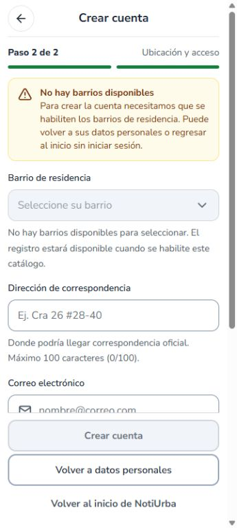
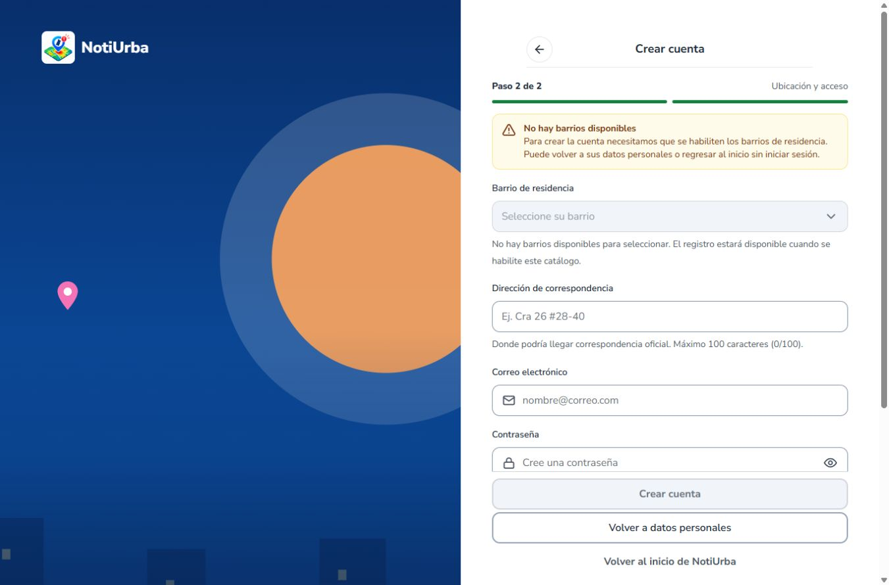
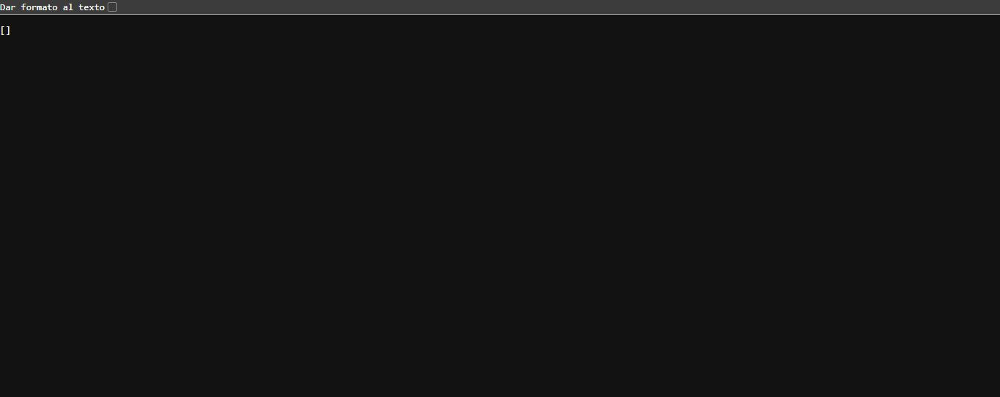

# NOT-71 — Revisión de barrios y bloqueo E2E

> Actualización posterior del 8 de noviembre: el QA recuperado de 5175/18091 ya devuelve 135 barrios. Registro HTTP 201 comprobado; login bloqueado por correo sin verificar. Render agotó el tiempo de espera en la revisión posterior. Véase [resultado final QA y preparación de migración](2026-11-08-NOT-71-final-QA.md). El texto siguiente conserva el corte histórico anterior de 5174.

Actualización verificada — 8 de noviembre de 2026
Estado: NOT-71 NO APROBADA / bloqueo de registro confirmado. Linear figura actualmente In Review; revisión no equivale a cumplimiento del criterio de aceptación.

Entorno y control de cambios
Repositorio C:\notiurba\noti-urba, rama fix/registro-pr20, HEAD e61c44001231b595fdb2faa8866154fed79559ac; árbol inicialmente limpio. PR #27 abierto como borrador, mismo HEAD, base develop e5d73c43da8331f3e6f524eda0724652471c4f83. Se conservaron cambios, respaldos y evidencias. No hubo commits, push, merge, despliegues, migraciones ni cambios de infraestructura o datos productivos.

Fallas activas confirmadas
INC-01: GET https://notiurba-api.onrender.com/api/catalogos/barrios responde HTTP 200 con [] (0 barrios públicos). El mismo GET vía http://127.0.0.1:5174/api/catalogos/barrios responde 200 [] y conserva x-render-origin-server: Render. El registro local en paso 2 muestra “No hay barrios disponibles”; selector idBarrio deshabilitado, 0 opciones con valor y Crear cuenta deshabilitado. Confirmado en Chrome a 360 y 1366 px. No es posible seleccionar Centro ni demostrar nuevamente su conservación.
Limitación local: el backend QA anterior http://127.0.0.1:18090/api/catalogos/barrios rechaza la conexión (ECONNREFUSED). No se recreó la base ni se sustituyó su catálogo por datos simulados.

API utilizada y alcance local
Vite 5174 sigue disponible; no fue necesario iniciarlo. El módulo servido /src/compartido/api/cliente.js declara VITE_USAR_MOCKS=false y VITE_API_URL vacío: petición relativa /api mediante el proxy hacia Render. Aunque .env.local conserva VITE_USAR_MOCKS=true, no es el valor efectivo del servidor 5174. frontend/vite.config.js apunta a Render; output/vite-barrios-qa.mjs conserva la configuración histórica hacia 18090 y no demuestra que hoy se use ese backend.
Netlify https://notiurba.netlify.app/registro responde HTTP 200; el bundle /assets/index-DtWzeXbA.js contiene la API https://notiurba-api.onrender.com. Esto acredita disponibilidad HTTP/configuración, no el recorrido E2E.

Pruebas aprobadas y evidencias reutilizadas
Se conserva chrome-resultado.json del 7 de noviembre (2026-11-07T23:54:49.473Z): HTTP 200, 135 opciones reales en QA desechable sin mocks, Centro idBarrio=43/idComuna=4, conservado=43 al volver y avanzar, sin escrituras HTTP. No es un resultado actual ni productivo.
Se reutilizan 32 pruebas frontend, CatalogoCargaBarriosIT y las evidencias previas de registro, navegación y fotografías sin repetir suites. NOT-25 demostró persistencia de foto/código en QA con almacenamiento local, no Cloudinary productivo.
Hoy se comprobó navegación entre pasos y el estado vacío a 360/1366 px. El DOM no mostró desbordamiento horizontal en las mediciones; esto no constituye una auditoría responsive completa ni prueba de teclado real.

Fallas corregidas / observaciones históricas
Se mantiene INC-03 como corregida en el simulador según NOT-62. El formulario actual muestra dirección limitada a 100 caracteres y contador. Las correcciones previas de privacidad, navegación y scroll mantienen el alcance de sus evidencias locales. INC-02 (hooks/pantalla transitoria) continúa como antecedente pendiente de reproducción; no se declara defecto productivo activo.

V17 y bloqueos de cierre
V17 permanece en backend/migraciones-pendientes/barrios-pmgr-2020, fuera de las ubicaciones activas de Flyway. Los 135 registros provienen de PMGR 2020 y no certifican vigencia administrativa en 2026. Siguen pendientes las decisiones B01–B05 y la aprobación de vigencia/alcance, catálogo definitivo, respaldo de base recuperable y autorización de carga. No se aplicó V17 ni se consultó o modificó Neon en esta revisión.
QA-E2E-01 está bloqueada por INC-01. QA-E2E-02–07 siguen pendientes: sesión de la cuenta nueva, reporte con foto, comuna derivada de coordenadas, destino persistido, almacenamiento productivo/URL recuperable y código consultable en el mismo recorrido Netlify → Render → base de datos.
No se creó ninguna cuenta/reporte productivo ni se enviaron correos a entidades. La restricción del usuario de no escribir datos productivos se conservó. Tras habilitar el catálogo, debe acordarse el caso sintético autorizado y garantizar que no enviará correos a entidades antes de ejecutar los POST del recorrido.

Evidencias nuevas
docs/validacion/evidencias-NOT-71-20261108/http.json
docs/validacion/evidencias-NOT-71-20261108/registro-360.png
docs/validacion/evidencias-NOT-71-20261108/registro-1366.png
docs/validacion/evidencias-NOT-71-20261108/render-barrios.png
Las capturas corresponden a Chrome real y los datos personales usados fueron sintéticos; no se remitió el formulario.

## Capturas auténticas

