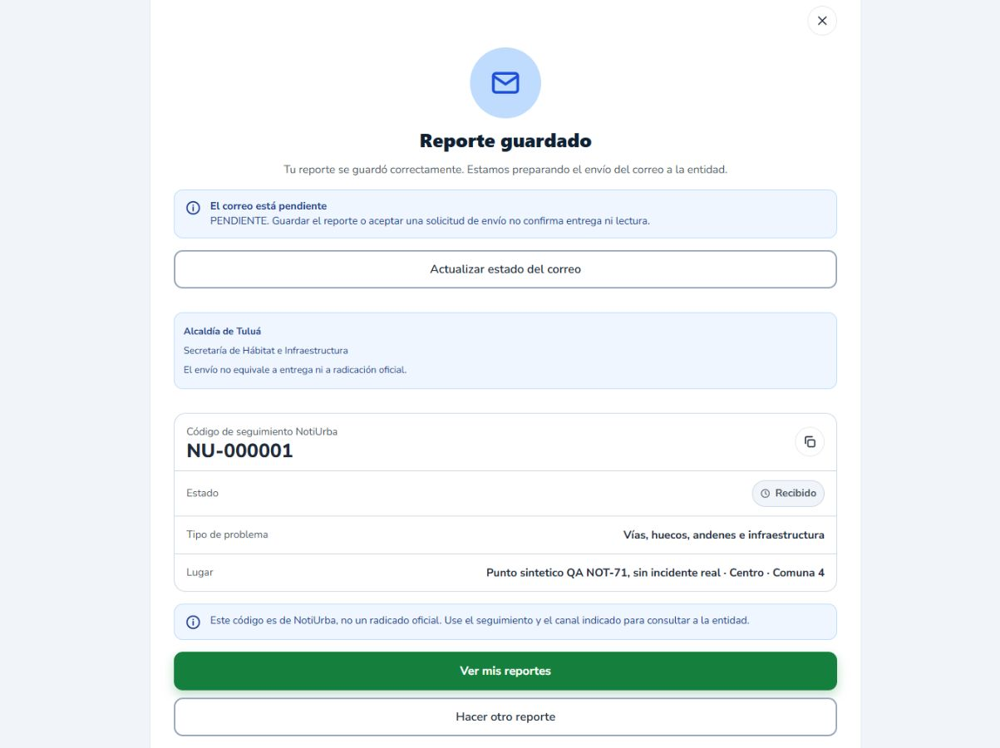
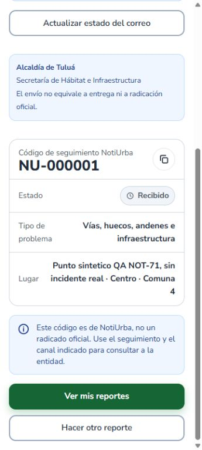
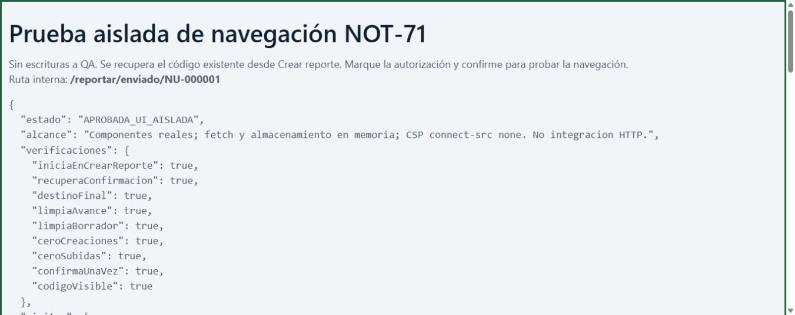

# NOT-71: validacion visual final y navegacion segura en QA

**Auditoria productiva posterior:** [estado de despliegues, bloqueos y procedimiento seguro](2026-11-08-NOT-71-auditoria-produccion.md). Las aprobaciones QA inferiores se conservan; la E2E con escrituras productivas aun no esta habilitada. La auditoria no repitio QA ni aplico cambios productivos.

8 de noviembre de 2026, America/Bogota. Rama `fix/registro-pr20`, HEAD `e61c44001231b595fdb2faa8866154fed79559ac`. **Estado: In Review; QA verificada dentro del alcance descrito, E2E productiva pendiente.**

## Evidencias reales reutilizadas

El usuario ejecuto el launcher corregido desde PowerShell 7. Se leyeron y contrastaron, sin repetir las operaciones:

- `evidencias-NOT-71-reporte-20261108/foto-local-20261108-181419.json`: API `127.0.0.1:18092`, login 200 previo, subida 201 al mismo NU-000001, URL local recuperada, SHA256 identico al JPEG original de 84460 bytes, estado APROBADO_FOTO_Y_PERSISTENCIA_QA.
- `evidencias-NOT-71-reporte-20261108/persistencia-SQL-20261108-181423.json`: lectura SQL real ejecutada por el usuario, base `notiurba_barrios_qa`, usuario SQL `qa_barrios`; reporte 1/NU-000001, ciudadano 2, categoria 1, coordenadas `(4.084847878371718,-76.1953353881836)`, comuna 4 derivada de poligono, entidad 1/Alcaldia de Tulua, foto idEvidencia 1/orden 1/usuario 2. Destino derivado y congelado coinciden; correo PENDIENTE, enviadoEn null.

La foto SQL y la consulta HTTP contienen la misma URL y codigo. SHA256 recuperado: `761d2113cbbccd6600366f6885f1cc1e656d33476780628150878faf178b6b67`. El 502 anterior queda como antecedente del backend 18091 mal configurado para fotos; la operacion con el adaptador aislado 18092 esta aprobada en estas evidencias. No acredita Cloudinary productivo.

No se volvieron a ejecutar barrios, registro, subida de foto ni SQL. Fue necesario abrir la sesion web existente en el origen 5176 para acceder a la pagina; no se registro otra cuenta ni se reabrio el caso de prueba de login.

## Confirmacion real en Chrome

URL: `http://127.0.0.1:5176/reportar/enviado/NU-000001`, frontend conectado al backend local 18092, con el adaptador real ya iniciado. La pagina mostro Reporte guardado, NU-000001, Recibido, categoria Vias/huecos/andenes, Centro, comuna 4 y Alcaldia de Tulua / Secretaria de Habitat e Infraestructura. El estado del correo se asento en PENDIENTE tras la carga; no se interpreta como entrega ni radicacion.

| Vista | Medicion | Resultado |
|---|---|---|
| Escritorio | viewport 1366 x 900; scrollWidth/clientWidth 1351/1351 (barra vertical de 15 px) | APROBADA: titulo, codigo y datos correctos, sin desbordamiento horizontal |
| Movil | viewport 360 x 800; scrollWidth/clientWidth 345/345 (barra vertical de 15 px) | APROBADA: codigo legible, textos adaptados, sin desbordamiento horizontal |
| Controles en movil | Ver mis reportes y Hacer otro reporte visibles por scroll, top/bottom dentro del viewport | APROBADA: enlaces inferiores alcanzables; no se pulso Hacer otro reporte |

Las capturas corresponden a Chrome real con viewport emulado, no a una nueva prueba en telefono fisico. Se restauro el viewport de Chrome al terminar. Se conservo abierta la pagina real del reporte.

## Regresion segura de navegacion: nueve comprobaciones aprobadas

Se preparo `frontend/qa/not71-navegacion.html` y su modulo JSX, disponible solo en DEV y origen local 5176. Monta los componentes reales ReportarLayout, PasoConfirmacion y ReporteEnviado con MemoryRouter. Parte de `/reportar` con el avance de NU-000001 ya guardado y una foto conciliada. Es el recorrido de recuperacion del reporte existente desde Crear reporte, no una segunda creacion.

La prueba utiliza dependencias HTTP sustituidas y almacenamiento en memoria exclusivos de esa ventana; no sobrescribe el token ni el borrador reales. La politica CSP `connect-src 'none'; form-action 'none'` impide conexiones de escritura. La respuesta de la solicitud de envio es ficticia y se identifica como simulada. No hay solicitudes reales a `/api/reportes`, `/fotos` ni `/enviar`; no hay nueva cuenta, reporte, foto o correo. **Es una regresion de UI, no una nueva prueba de integracion HTTP, autenticacion o persistencia.**

Se accionaron los controles reales de confirmar mediante Chrome. El resultado registrado fue APROBADA_UI_AISLADA, con nueve aserciones verdaderas:

1. Entrada desde `/reportar`.
2. Recuperacion automatica de `/reportar/confirmacion`.
3. Destino `/reportar/enviado/NU-000001`.
4. Avance guardado limpiado despues de alcanzar el resultado.
5. Borrador vacio al terminar.
6. Ninguna llamada, ni siquiera simulada, de creacion de reporte.
7. Ninguna llamada de subida de foto.
8. Una sola confirmacion simulada del mismo codigo.
9. Codigo NU-000001 visible en el componente final.

Secuencia observada: `/reportar` -> `/reportar/confirmacion` -> `/reportar/enviado/NU-000001`. No volvio al paso Categoria despues de guardar. La navegacion utiliza el `navigate()` y la limpieza diferida del codigo corregido, sin abrir directamente la ruta final en esta prueba. No se repite el POST de creacion real ni se demuestra con este caso una nueva creacion E2E completa.

ESLint del nuevo modulo QA: salida 0. No se modificaron de nuevo los componentes productivos, ni se repitieron suites ya aprobadas. La prueba se conserva para reproducir la regresion; tiene entrada independiente y no se integra en las rutas de la aplicacion.

## Evidencias nuevas

Carpeta `evidencias-NOT-71-visual-final-20261108/`:

- `resumen.json`: origen de evidencias reutilizadas, entorno, alcance y resultados.
- `escritorio.json`, `movil.json`, `movil-scroll.json`: dimensiones reales y controles.
- `confirmacion-1366.png`, `confirmacion-360-superior.png`, `confirmacion-360-inferior.png`: pagina real conectada a QA.
- `navegacion-aislada.json`, `navegacion-aislada.png`, `navegacion-aislada-resultados.png`: regresion de UI con dependencias sustituidas; no confundir sus capturas con integracion real.

Sin contrasenas ni JWT reales en capturas o resultados. Se conservaron el codigo local, archivos, respaldos, servicios y contenedores. No se ejecuto el recuperador ni se reinicio el launcher.

## Criterios pendientes de produccion

| Criterio NOT-71 | Estado al corte |
|---|---|
| Catalogo de barrios productivo aprobado y disponible | BLOQUEO previo conservado: ultimo resultado aportado Render 200 [] y V17 sin aplicar. No se volvio a consultar produccion |
| Registro/verificacion/login desde Netlify contra Render y Neon | PENDIENTE en un unico caso productivo autorizado; las aprobaciones QA no lo sustituyen |
| Reporte con foto usando almacenamiento productivo autorizado | PENDIENTE: archivos locales 19027 no validan Cloudinary productivo |
| Comuna, destino, foto y codigo persistidos en la base productiva | PENDIENTE de consulta de solo lectura del mismo caso E2E |
| Confirmacion automatica y consulta por codigo en el despliegue | PENDIENTE: correccion y regresion verificadas localmente, no desplegadas |
| Canal seguro de ensayo sin correo real a entidades | PENDIENTE de configuracion/autorizacion antes de cualquier POST productivo; el envio QA esta PENDIENTE |

V17 y B01-B05 se conservan sin modificar ni aplicar. No hubo cambios en Neon, Render, Netlify o Cloudinary, commits, push, PR o despliegues. **Mantener NOT-71 en In Review.** El alcance QA queda sustentado; el cierre requiere demostrar por separado la E2E Netlify -> Render -> Neon con las autorizaciones pendientes.
